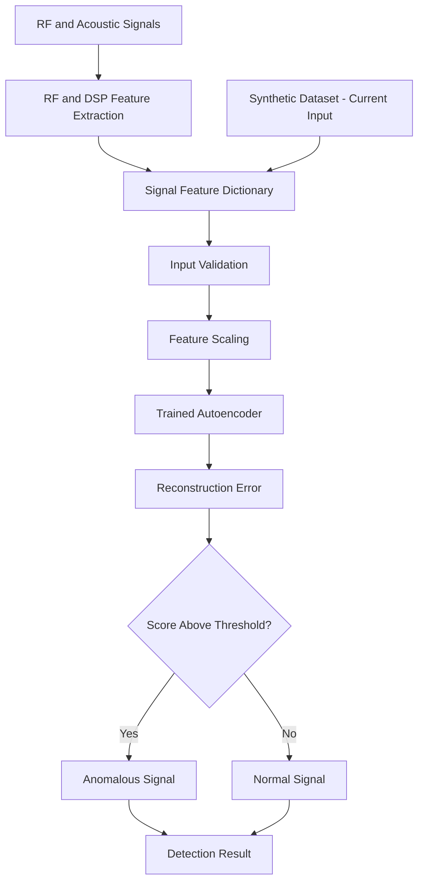
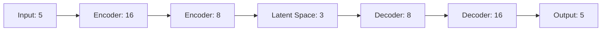
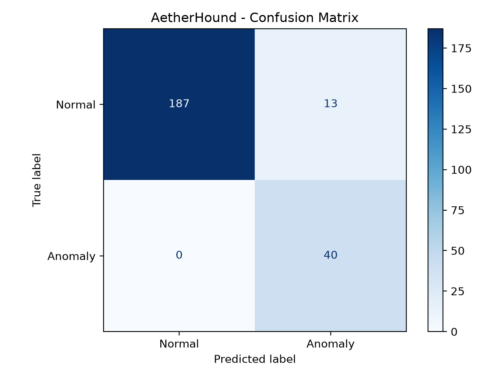
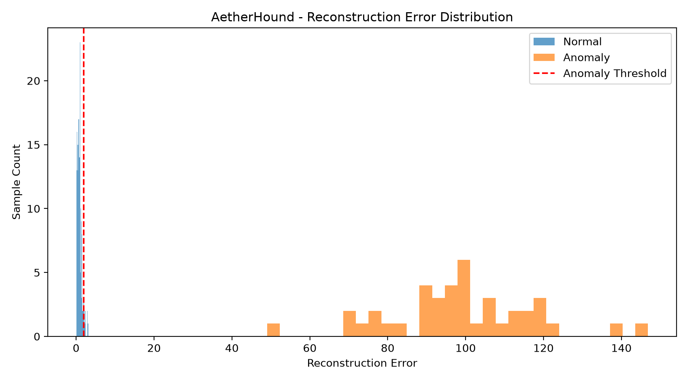

# AetherHound
### Air-Gapped RF & Acoustic Covert Channel Detector


---

## 1. Project Overview

AetherHound is a security-focused project designed to
identify suspicious patterns in Radio Frequency (RF)
and acoustic signals using machine learning and
anomaly detection techniques.

The ML module analyzes numerical signal features,
calculates anomaly scores, and classifies input
signals as normal or anomalous.

The current implementation is an offline ML prototype
trained and evaluated using synthetic signal data.

---

## 2. ML Module Objectives

- Generate synthetic normal and anomalous signal data.
- Implement an Isolation Forest baseline model.
- Develop a PyTorch Autoencoder for anomaly detection.
- Calculate reconstruction errors and anomaly scores.
- Determine an anomaly detection threshold.
- Validate incoming signal features.
- Provide a reusable prediction interface.
- Generate model evaluation graphs.
- Perform automated unit and interface testing.
- Support future RF and acoustic pipeline integration.

---

## 3. System Architecture



**Integration Note:** RF and DSP feature extraction
represents the intended system architecture.
The current ML prototype uses synthetic features.

---

## 4. Technology Stack

| Technology | Purpose |
|------------|---------|
| Python | Core implementation |
| NumPy | Numerical computations |
| Pandas | Dataset processing |
| Scikit-learn | Isolation Forest and feature scaling |
| PyTorch | Autoencoder implementation |
| Matplotlib | Evaluation visualization |
| Joblib | Scaler serialization |
| Pytest | Automated testing |
| VS Code | Development environment |
| Git and GitHub | Version control |

---

## 5. ML Module Directory Structure

```text
AetherHound/
│
├── ml/
│   ├── __init__.py
│   ├── dataset.py
│   ├── baseline.py
│   ├── autoencoder.py
│   ├── train.py
│   ├── predict.py
│   ├── evaluate.py
│   ├── interface.py
│   └── visualize.py
│
├── data/
│   └── synthetic_signals.csv
│
├── models/
│   ├── autoencoder.pt
│   ├── scaler.pkl
│   └── config.json
│
├── tests/
│   ├── test_ml.py
│   └── test_interface.py
│
├── docs/
│   └── figures/
│       ├── confusion_matrix.png
│       └── reconstruction_errors.png
│
├── demo_ml.py
├── requirements.txt
├── .gitignore
└── README.md
```

Generated datasets and trained model artifacts can
be recreated using the execution commands below.

---

## 6. Module Description

| File | Responsibility |
|------|----------------|
| dataset.py | Synthetic dataset generation |
| baseline.py | Isolation Forest implementation |
| autoencoder.py | Neural network architecture |
| train.py | Autoencoder training and model saving |
| predict.py | Anomaly score calculation |
| evaluate.py | Model performance evaluation |
| interface.py | Input validation and prediction API |
| visualize.py | Evaluation graph generation |
| test_ml.py | Model unit testing |
| test_interface.py | Interface validation testing |
| demo_ml.py | End-to-end ML demonstration |

---

## 7. Dataset Description

The synthetic dataset contains 1,200 signal samples.

| Signal Category | Samples |
|-----------------|---------|
| Normal Signals | 1,000 |
| Anomalous Signals | 200 |
| Total | 1,200 |

### Input Features

| Feature | Description |
|---------|-------------|
| signal_power | Signal power measurement |
| spectral_entropy | Spectral complexity |
| peak_frequency | Dominant signal frequency |
| bandwidth | Signal frequency range |
| noise_level | Estimated signal noise |

These features are synthetically generated for
initial model development and testing.

---

## 8. Machine Learning Models

### 8.1 Isolation Forest

Isolation Forest is an unsupervised anomaly
detection algorithm that identifies unusual
observations by isolating them from normal data.

It is used as the baseline model.

**Observed synthetic test accuracy: 93%**

### 8.2 PyTorch Autoencoder

The Autoencoder learns the representation of
normal signal features and reconstructs its input.

Suspicious samples may produce higher reconstruction
errors than normal samples.

### Autoencoder Architecture



### Training Configuration

| Parameter | Value |
|-----------|-------|
| Input Dimension | 5 |
| Latent Dimension | 3 |
| Training Epochs | 100 |
| Learning Rate | 0.001 |
| Optimizer | Adam |
| Loss Function | Mean Squared Error |
| Final Training Loss | 0.880297 |
| Anomaly Threshold | 1.969702 |

The model is trained on normal synthetic samples.
The anomaly threshold is calculated using normal
validation reconstruction errors.

---

## 9. Model Performance

### Accuracy Comparison

| Model | Synthetic Test Accuracy |
|-------|-------------------------|
| Isolation Forest | 93% |
| PyTorch Autoencoder | 95% |

### Autoencoder Classification Report

| Class | Precision | Recall | F1-Score | Support |
|-------|-----------|--------|----------|---------|
| Normal | 1.00 | 0.94 | 0.97 | 200 |
| Anomaly | 0.75 | 1.00 | 0.86 | 40 |
| Accuracy | | | 0.95 | 240 |
| Macro Average | 0.88 | 0.97 | 0.91 | 240 |
| Weighted Average | 0.96 | 0.95 | 0.95 | 240 |

### Confusion Matrix

| Actual / Predicted | Normal | Anomaly |
|--------------------|--------|---------|
| Normal | 187 | 13 |
| Anomaly | 0 | 40 |

- True Negatives: 187
- True Positives: 40
- False Positives: 13
- False Negatives: 0
- Exact Accuracy: 94.58%
- Anomaly Recall: 100%
- Normal Signal False Positive Rate: 6.5%

These results apply only to the synthetic test dataset.

---

## 10. Evaluation Graphs

### Confusion Matrix



### Reconstruction Error Distribution



Graphs can be regenerated using:

```bash
python -m ml.visualize
```

---

## 11. Installation and Setup

### Prerequisites

- Python 3.13 (tested development version)
- Git
- VS Code or another Python IDE
- Command Prompt or PowerShell

### Step 1: Clone Repository

```bash
git clone -b member/karthik --single-branch https://github.com/Coding666Legend/AetherHound-ITSol.git
cd AetherHound-ITSol
```

### Step 2: Create Virtual Environment

```bash
python -m venv venv
```

### Step 3: Activate Virtual Environment

Windows Command Prompt:

```cmd
venv\Scripts\activate.bat
```

Windows PowerShell:

```powershell
.\venv\Scripts\Activate.ps1
```

Linux/macOS:

```bash
source venv/bin/activate
```

### Step 4: Install Dependencies

```bash
python -m pip install --upgrade pip
python -m pip install -r requirements.txt
```

If requirements.txt is unavailable:

```bash
python -m pip install numpy pandas scikit-learn matplotlib torch joblib pytest
```

---

## 12. Execution Instructions

Run the following commands from the project root.

### Generate Dataset

```bash
python -m ml.dataset
```

### Run Baseline Model

```bash
python -m ml.baseline
```

### Train Autoencoder

```bash
python -m ml.train
```

### Evaluate Model

```bash
python -m ml.evaluate
```

### Run Anomaly Prediction

```bash
python -m ml.predict
```

### Run Integration Interface

```bash
python -m ml.interface
```

### Generate Evaluation Graphs

```bash
python -m ml.visualize
```

### Run Automated Tests

```bash
python -m pytest tests -v
```

### Run Final Demonstration

```bash
python demo_ml.py
```

---

## 13. Prediction Interface

The ML module exposes a reusable function named
detect_anomaly() for future system integration.

```python
from ml.interface import detect_anomaly

features = {
    "signal_power": 0.95,
    "spectral_entropy": 0.25,
    "peak_frequency": 1900,
    "bandwidth": 550,
    "noise_level": 0.45
}

result = detect_anomaly(features)

print(result)
```

### Observed Output

```python
{
    "anomaly_score": 126.593994140625,
    "threshold": 1.969702124595642,
    "is_anomaly": True
}
```

### Detection Logic

- Score above threshold: ANOMALY
- Score at or below threshold: NORMAL

---

## 14. Input Validation

The prediction interface validates input before
passing it to the trained model.

Validation includes:

- Required feature verification.
- Missing feature detection.
- Unexpected feature rejection.
- Numerical data type validation.
- Boolean value rejection.
- NaN value rejection.
- Infinite value rejection.

This prevents invalid signal data from reaching
the prediction pipeline.

---

## 15. Automated Testing

The ML module was tested using Pytest.

| Test Case | Status |
|-----------|--------|
| Valid Input | PASSED |
| Missing Feature | PASSED |
| Extra Feature | PASSED |
| Invalid Data Type | PASSED |
| NaN Value | PASSED |
| Infinite Value | PASSED |
| Autoencoder Output Shape | PASSED |
| Anomaly Prediction | PASSED |

### Latest Observed Test Summary

```text
Total Tests : 8
Passed      : 8
Failed      : 0
Pass Rate   : 100%

8 passed in 15.77s
```

---

## 16. Demonstration Results

```text
AETHERHOUND ML DETECTION DEMO
========================================

Sample: Normal Signal
Anomaly Score: 0.0032
Threshold: 1.9697
Detection: NORMAL

Sample: Suspicious Signal
Anomaly Score: 126.5940
Threshold: 1.9697
Detection: ANOMALY
```

The demonstration successfully classified both
selected synthetic signal samples.

---

## 17. Day 3 Development Progress

### ML and Analytics Module

- [x] Synthetic dataset generation
- [x] Isolation Forest baseline
- [x] Autoencoder architecture
- [x] Model training and serialization
- [x] Anomaly threshold calculation
- [x] Model evaluation
- [x] Prediction interface
- [x] Input validation
- [x] Confusion matrix visualization
- [x] Reconstruction error visualization
- [x] Automated unit testing
- [x] Automated interface testing
- [x] Successful demonstration
- [ ] Real RF feature integration
- [ ] Real acoustic feature integration
- [ ] Representative signal validation
- [ ] End-to-end system integration

### Issues Resolved

During interface testing, three validation issues
were identified and resolved:

| Issue | Resolution |
|-------|------------|
| Extra features accepted | Added unexpected feature validation |
| Invalid data types accepted | Added numerical type validation |
| NaN values accepted | Added finite number validation |

After applying these fixes, all eight automated
tests passed successfully.

---

## 18. Integration Requirements

The RF and DSP modules must provide a consistent
feature dictionary to the ML prediction interface.

Before real-world deployment:

1. Define feature calculation methods and units.
2. Collect representative RF and acoustic data.
3. Validate the extracted features.
4. Retrain the model using representative normal data.
5. Recalibrate the anomaly threshold.
6. Evaluate detection performance and false positives.
7. Integrate the prediction interface with the system.

---

## 19. Current Limitations

- The model is trained on synthetic numerical data.
- Real RF and acoustic signal validation is pending.
- Anomalous behavior does not necessarily indicate
  a covert communication channel.
- The observed accuracy does not establish
  real-world detection performance.
- Model artifacts must be loaded from trusted sources.

---

## 20. Future Enhancements

- Real-time signal anomaly detection.
- RF and acoustic feature pipeline integration.
- Representative dataset collection.
- Improved anomaly threshold calibration.
- False positive reduction.
- Detection logging and reporting.
- Performance optimization for offline environments.
- Integration with the central AetherHound system.

---

## 21. Project Team

| Member | Responsibility |
|--------|----------------|
| Member 01 | System Architecture and Integration |
| Member 02 | RF and Signal Acquisition |
| Member 03 | DSP and Acoustic Engineering |
| Member 04 | Machine Learning and Analytics |

---

## 22. Current Project Status

**ML Prototype:** Implemented and Tested

**Automated Tests:** 8/8 Passed

**Synthetic Test Accuracy:** Approximately 95%

**RF/DSP Integration:** Pending

**Real-World Validation:** Pending

---

### AetherHound

*Signal Analysis | Machine Learning | Anomaly Detection*
# AetherHound-ITSol
InfoTact Solutions - Project Repo To AetherHound
