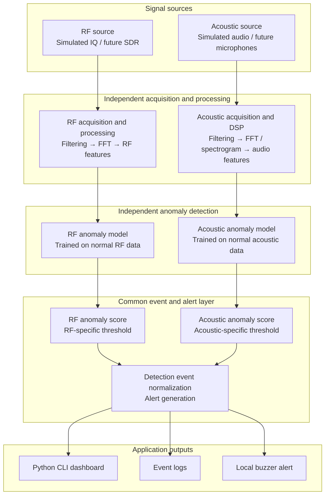

# AetherHound — System Architecture

**Project:** Air-Gapped RF & Acoustic Covert Channel Detector  
**Domain:** Hardware Security / Signals Intelligence (SIGINT)  
**Status:** High-level architecture finalized; implementation parameters remain subject to testing.

## 1. Purpose

AetherHound is intended to detect potential covert data transmission from air-gapped servers through abnormal electromagnetic (RF) emissions and acoustic emissions. The system learns normal server-room RF and acoustic behaviour and flags unusual structured patterns that may indicate covert signalling.

The project brief identifies Software Defined Radios (SDRs), ultrasonic microphones, digital signal processing (DSP), an autoencoder-based anomaly detection approach, and a local command-line interface (CLI).

## 2. Architectural decisions

1. RF and acoustic signals use independent acquisition and processing pipelines.
2. RF and acoustic signals use **separate anomaly-detection models**.
3. Each model is trained on normal data from its own modality.
4. Each model uses its own feature representation, reconstruction-error calculation, and anomaly threshold.
5. Both models emit a common `DetectionEvent` structure.
6. A shared event/alert layer forwards detections to the CLI and logging components.
7. Development begins with simulated signal sources and compatible input interfaces. Physical hardware integration can be added when the hardware is available.

### Why separate models?

RF and acoustic signals are different data modalities. Their sample representations, preprocessing, feature distributions, and useful anomaly characteristics are not interchangeable. Separate models allow each modality to be trained and evaluated independently. The common event interface keeps the rest of the application independent of those model differences.

An RF anomaly score must not be interpreted using the acoustic model's threshold, or vice versa. Scores from the two models are not assumed to be directly comparable.

## 3. System architecture

## 4. Component responsibilities

### 4.1 Signal acquisition

**RF path**
- Initial source: simulated IQ samples.
- Future source: SDR hardware, with HackRF identified in the project brief.
- Owner: M02 — Sarang.

**Acoustic path**
- Initial source: simulated audio samples.
- Future source: ultrasonic microphone array identified in the project brief.
- Owner: M03 — Piyush.

The acquisition interfaces should isolate the rest of the system from whether samples came from a simulator or physical hardware.

### 4.2 Signal processing

**RF processing**
- Accept RF samples.
- Apply the RF processing required by the implementation.
- Use FFT/spectral analysis and produce RF features for the RF model.
- Owner: M02 — Sarang.

**Acoustic processing**
- Accept audio samples.
- Apply filtering and noise reduction.
- Generate spectrograms and extract features for the acoustic model.
- Owner: M03 — Piyush.

The exact filters, window sizes, FFT parameters, and feature dimensions are implementation decisions to be established through testing. They are not fixed by this architecture document.

### 4.3 Anomaly detection

**RF anomaly model**
- Receives RF features.
- Learns normal RF behaviour from normal RF training data.
- Produces an RF reconstruction error / anomaly score.
- Applies an RF-specific threshold.
- Owner: M04 — Karthik.

**Acoustic anomaly model**
- Receives acoustic features.
- Learns normal acoustic behaviour from normal acoustic training data.
- Produces an acoustic reconstruction error / anomaly score.
- Applies an acoustic-specific threshold.
- Owner: M04 — Karthik.

The project brief specifies an autoencoder trained solely on normal server emissions. The choice to maintain one RF autoencoder and one acoustic autoencoder is the team's architecture decision.

### 4.4 Detection and alert layer

- Accepts detection results from either model.
- Preserves modality and source information.
- Normalizes outputs into the common `DetectionEvent` contract.
- Routes events to the CLI and log writer.
- Triggers the local buzzer for configured anomalous events.

The event layer must not merge or compare raw RF and acoustic anomaly scores. Each model determines its own anomaly decision.

### 4.5 CLI and logging

The CLI is a local Python terminal interface, using Curses or Rich as selected during implementation. It should present monitoring information and detected anomalies.

The project brief calls for:
- Live RF spectrum/waterfall display.
- A CLI update target of 30+ frames per second at the mid-project review.
- A visual alert and local buzzer when anomalous reconstruction error is detected.
- Log entries recording the exact timestamp and frequency of a covert transmission.

For acoustic events, frequency may be recorded when the acoustic processing module can provide a meaningful frequency value. The event contract therefore permits frequency to be absent.

Owner: M01 — Aditya.

## 5. Shared data contracts

The detailed field definitions and Python interfaces are maintained in `module_interfaces.md`.

- `SignalFrame`: raw signal samples from an acquisition source.
- `FeatureFrame`: modality-specific processed features.
- `DetectionEvent`: standardized anomaly result from either model.

These contracts are the integration boundary between independently developed modules.

## 6. Team ownership

| Member | Primary ownership | Key outputs |
|---|---|---|
| M01 — Aditya | System architecture, interfaces, integration, CLI, GitHub coordination | Architecture and interface documentation, main application, integrated CLI |
| M02 — Sarang | RF simulation and acquisition | RF generator, IQ datasets, RF input interface |
| M03 — Piyush | Acoustic simulation and DSP | Audio generator, DSP processing, spectrograms, acoustic features |
| M04 — Karthik | ML and anomaly detection | Training scripts, separate RF/acoustic models, scoring and evaluation |

All members should understand the overall architecture and communicate interface requirements. Ownership is primary responsibility, not isolation.

## 7. Development and integration principles

1. Start with simulated RF and acoustic inputs while dedicated hardware is unavailable.
2. Keep simulation and future hardware behind compatible acquisition interfaces.
3. Develop the RF and acoustic pipelines independently.
4. Agree on data contracts before connecting modules.
5. Integrate progressively; do not defer all integration until the end.
6. Keep modality-specific model training, scoring, and thresholds independent.
7. Test each module independently before end-to-end integration.

## 8. Requirements traceability

| Project brief requirement | Architectural component |
|---|---|
| SDR and ultrasonic microphone acquisition | RF and acoustic acquisition paths |
| GNU Radio and Python DSP | Signal-processing paths |
| Filtering of RF/audio noise | Modality-specific processing |
| FFT and spectrogram matrices | Signal-processing paths |
| Autoencoder trained on normal emissions | Separate RF and acoustic anomaly models |
| Local Python CLI using Curses/Rich | CLI dashboard |
| 30+ FPS CLI update target at mid-review | CLI performance validation |
| Anomaly visual alert and local buzzer | Event/alert layer |
| Timestamp and frequency logging | Event logging |
| C++ optimization of heavy DSP matrix math in Week 4 | Later optimization task, after profiling |

## 9. Open implementation decisions

The following are intentionally not hard-coded in the architecture:
- RF and acoustic sample rates and capture-window lengths.
- Filter types and parameters.
- FFT sizes, overlap, and spectrogram configuration.
- Feature names and feature-vector dimensions.
- Autoencoder layer sizes and training parameters.
- Per-model anomaly thresholds.
- Exact CLI layout and refresh strategy.
- Hardware availability and deployment configuration.

These should be selected by the module owners, documented, and validated with test data before integration.

## 10. Source basis

- `PROJECT.pdf`, Project 2 — “AetherHound”: project problem statement, novel idea, key modules, and four-week development plan.
- `AetherHound - Team Responsibility Matrix.md`: member ownership, deliverables, responsibility boundaries, and collaboration expectations.

Architecture choices explicitly selected by the team—especially separate RF and acoustic models and simulation-first integration—are design decisions, not verbatim requirements from the project brief.
